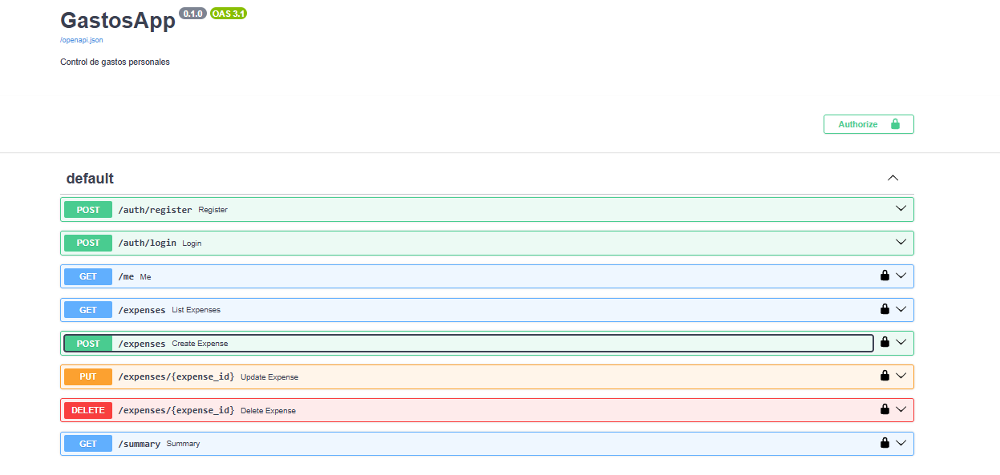
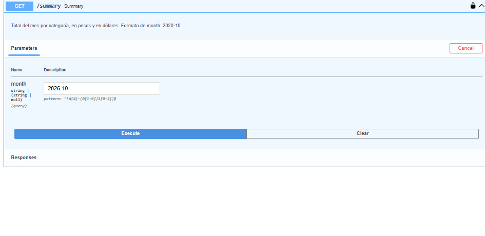
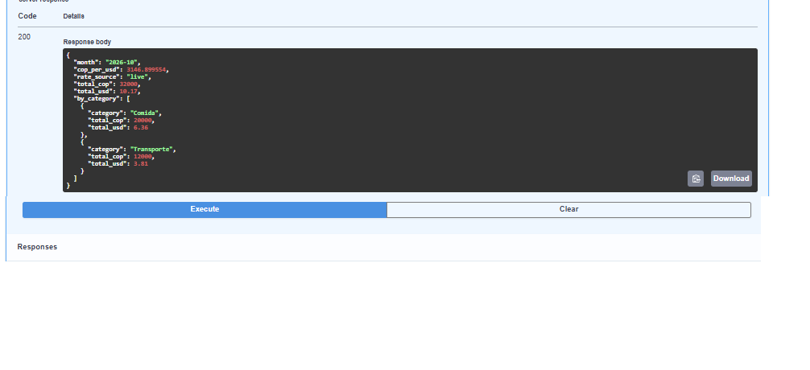

# GastosApp

API REST para control de gastos personales, hecha con **Python y FastAPI**. Cada usuario se registra, inicia sesión y administra únicamente sus propios gastos. Incluye un resumen mensual por categoría en pesos colombianos (COP) y en dólares (USD), usando una API externa de tasas de cambio.

**Demo en vivo:** https://gastosapp-73x6.onrender.com (abre directamente la documentación interactiva)

> La demo corre en un plan gratuito: si lleva un rato sin uso, la primera carga puede tardar cerca de un minuto, y los datos de prueba pueden reiniciarse en cada despliegue.

## Capturas





## Qué hace

- Registro e inicio de sesión de usuarios.
- Crear, listar, editar y eliminar gastos (descripción, categoría, monto en COP y fecha).
- Resumen mensual por categoría, con el total también en USD.
- Cada usuario solo puede ver y modificar sus propios gastos.

## Tecnologías

| Área | Herramienta |
|---|---|
| Backend | Python, FastAPI, Uvicorn |
| Base de datos | SQLAlchemy (SQLite en local y en la demo; el motor se cambia con la variable `DATABASE_URL`) |
| Validación | Pydantic |
| Seguridad | Contraseñas cifradas con bcrypt, autenticación con tokens JWT |
| Integración externa | API pública de tasas de cambio (`httpx`) |
| Pruebas | pytest |
| Despliegue | Render, desde GitHub |

## Endpoints

| Método | Ruta | Descripción |
|---|---|---|
| POST | `/auth/register` | Crear una cuenta |
| POST | `/auth/login` | Iniciar sesión y recibir el token |
| GET | `/me` | Datos del usuario autenticado |
| POST | `/expenses` | Crear un gasto |
| GET | `/expenses` | Listar los gastos del usuario |
| PUT | `/expenses/{id}` | Editar un gasto propio |
| DELETE | `/expenses/{id}` | Eliminar un gasto propio |
| GET | `/summary?month=2026-10` | Resumen del mes por categoría, en COP y USD |

La documentación interactiva está en `/docs`.

## Decisiones de diseño y seguridad

- Las contraseñas nunca se guardan en texto plano: se cifran con bcrypt.
- La clave que firma los tokens vive en la variable de entorno `SECRET_KEY`, no en el código. El archivo `.env` real está excluido del repositorio con `.gitignore`; `.env.example` sirve de plantilla.
- Si alguien intenta acceder al gasto de otra persona, la API responde 404 y no 403, para no revelar que ese gasto existe.
- Si la API de tasas de cambio falla, la aplicación no se cae: usa un valor de respaldo aproximado y lo indica en el campo `rate_source` (`live` o `fallback`). La tasa se guarda en memoria durante una hora para no consultar la API en cada petición.
- Las pruebas de la integración simulan la API externa, así que no dependen de internet.

## Cómo correrlo en local

Requiere Python 3.10 o superior.

```bash
git clone https://github.com/marlonrestrepoGIT/gastosapp.git
cd gastosapp
python -m venv venv
venv\Scripts\activate        # en Mac/Linux: source venv/bin/activate
pip install -r requirements.txt
uvicorn app.main:app --reload
```

Luego abre http://127.0.0.1:8000, que redirige a la documentación.

Variables de entorno opcionales (ver `.env.example`):

- `SECRET_KEY`: clave para firmar los tokens. En local se usa una clave de desarrollo si no se define.
- `DATABASE_URL`: por defecto `sqlite:///./gastos.db`.
- `FALLBACK_COP_PER_USD`: tasa de respaldo si la API externa no responde.

## Pruebas

```bash
pytest
```

Cubren registro, inicio de sesión, acceso sin token, el CRUD de gastos (incluido que un usuario no pueda ver ni modificar los gastos de otro), el resumen mensual y la integración con la tasa de cambio.

## Estructura

```
app/
  main.py        Rutas de la API
  models.py      Tablas de la base de datos
  schemas.py     Validación de datos de entrada y salida
  security.py    Cifrado de contraseñas y tokens JWT
  services.py    Integración con la API de tasas de cambio
  database.py    Conexión a la base de datos
tests/           Pruebas automáticas
```

## Posibles mejoras

- Migrar la demo a PostgreSQL para que los datos persistan entre despliegues.
- Interfaz web propia para consumir la API.
- Actualización parcial de gastos con `PATCH`.

## Autor

Marlon Restrepo · Ingeniero de Sistemas y Computación (UTP) · Pereira, Colombia
